# HostTalk

A chat room for one local network. One machine runs the server. Everyone else opens a browser and joins with a name and the room password.

Version 2.2.0, codename Roll call. Apache 2.0. Changes per release: [CHANGELOG.md](CHANGELOG.md).

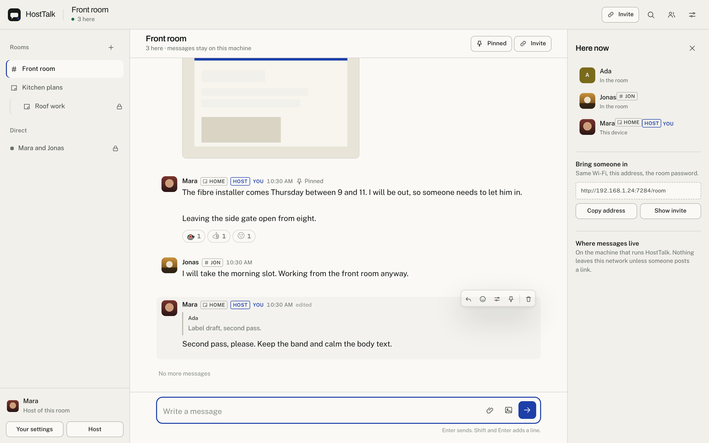

Messages live in a SQLite file on the host machine. They move between the browser and the host over the local network. No account, no cloud relay, no monthly bill. The screenshots in this file come from a demo room set up for the purpose. The people, names, and messages are placeholders.

## Contents

- [What this build adds](#what-this-build-adds)
- [Screens](#screens)
- [Project stats](#project-stats)
- [Project page](#project-page)
- [How it works](#how-it-works)
- [Run it](#run-it)
- [Desktop app](#desktop-app)
- [Set up the room](#set-up-the-room)
- [Deploy it](#deploy-it)
- [Settings](#settings)
- [Command line](#command-line)
- [HTTP API](#http-api)
- [Data folder](#data-folder)
- [Security model](#security-model)
- [Tests](#tests)
- [Troubleshooting](#troubleshooting)
- [Repository layout](#repository-layout)

## What this build adds

The 1.x build shipped one room, a five character password check, and a page with a fixed port. This build rebuilds the server, the storage, and the interface.

### Rooms and people

- **Group rooms.** Named rooms hold 20 people by default. The host sets the cap. A full room refuses new members with a clear message.
- **Direct threads.** Two people open a private thread from the people panel. The thread appears in the sidebar for both.
- **DM passwords.** A member sets a password on a direct thread. The other side types it once and the browser remembers the pass for the session.
- **Invite links.** Each room issues a code with a use limit and a 7 day expiry. The link opens the join page with the code filled in.
- **Unique colors.** The server hands out a color from a 20 step palette. Every entry meets a 4.5 to 1 contrast ratio against white text, so names stay readable.
- **Nickname change.** A person renames in the settings sheet. The server enforces a one hour cooldown and writes each change to a log the host reads in the console.
- **House name.** A blank name joins as John Appleseed. The next guest becomes John Appleseed 2, and so on.
- **Name tied to the device.** The server remembers the device key, so the same browser returns with the same name, picture, role, and badge.
- **Profile pictures.** Upload a PNG, JPEG, GIF, WebP, or AVIF up to 3 MB. Initials stay as the fallback.
- **Roles.** Host, moderator, member. The first person in the room gets the host role. The host console moves roles, including the host role.
- **Badges.** One icon and up to four characters beside the name. Each person picks their own.
- **Rooms inside rooms.** Create a room from inside another room. Members of the outer room see it, then enter with the inner password if it has one.

### Messages

- **Quoting.** Reply attaches the original message as a quote. The quote jumps to the source on click.
- **Reactions.** Any emoji, toggled per person. The picker offers a common set and takes any emoji typed or pasted by hand.
- **Custom emoji.** The host uploads small pictures as named emoji. Everyone reacts with them.
- **Pinned messages.** The host and moderators pin a message. The pinned sheet jumps back to it.
- **Hover toolbar.** Reply, react, edit, pin, and delete sit in a floating row that appears on hover, with a divider before delete.
- **Two tones.** A short tone plays when a message leaves, and another when one arrives. Both ship as small files under `static/`, and the Sounds switch turns them off.
- **Edit and delete.** Authors edit or delete their own text. Delete leaves a quiet placeholder so the thread keeps its shape.
- **Search.** The search sheet queries the rooms you belong to and jumps to the match.
- **Link previews.** The server fetches a page title, description, and image. Private and loopback addresses are refused before any request leaves the machine.
- **GIF search.** KLIPY search runs through the host, so the API key stays on the host. Media loads straight from KLIPY. Search is off until a key is set.
- **Typing and presence.** Typing pings and presence changes arrive over one server-sent event stream.

### Files

- **20 MB limit.** The host sets the number in the console. The server checks it again after compression.
- **Client compression.** An oversized image is resized and re-encoded in the browser before upload. The original file stays untouched on disk.
- **Any file type.** Images render in the thread. Everything else downloads as an attachment with its original name, size, and a SHA-256 digest.
- **Drag, paste, pick.** Drop a file on the thread, paste from the clipboard, or use the paperclip.

### Host tools

- **A real console.** `/console` shows checks, people, rooms, logs, settings, LocalSend state, exports, and a stop button. It runs in a browser and replaces the terminal.
- **Host sign in.** A host name and a host password, separate from the join password. Both change on the hosting machine only.
- **Room controls.** Lock the room to new people, set read only, set slow mode, and post a notice above the thread.
- **Role control.** The people table carries a role menu for every account.
- **Password change and reset.** The host changes the join password in the console or with one command. Both paths use bcrypt and store no plain text.
- **Cleaner logs.** JSON lines, level filtering in the console, rotation at 2 MB with three backups, and a download button.
- **Configurable port.** The default is 7284. The host edits the port in the console or in `config.json`. Port 6767 is gone.

### Network tools

- **LocalSend interop.** The server announces itself over multicast on UDP 53317 and answers the LocalSend v2 protocol. Files a phone sends land in the main room. The console lists devices seen on the network.
- **Doctor command.** `python -m hosttalk doctor` checks the port, the data folder, free space, the network address, the GIF key, and the console reach before you invite anyone.

### Pages

- **A front page.** `/` shows live counts, the room address, and one button into the room. Server rendered, no script.
- **A project stats page.** `/stats` counts this instance, the code in the build, and the versions under both.
- **A static project page.** `site/index.html` explains the project for a reader who has not started the server yet. Source in `landing/`.

## Screens

The images below come from the 2.2 build: badges, profile pictures, rooms inside rooms, and a hover toolbar on each message. `docs/SCREENSHOTS.md` records how the set is made.

Every server starts on a front page. Live counts, the room address, and one button into the room. The page needs no script.

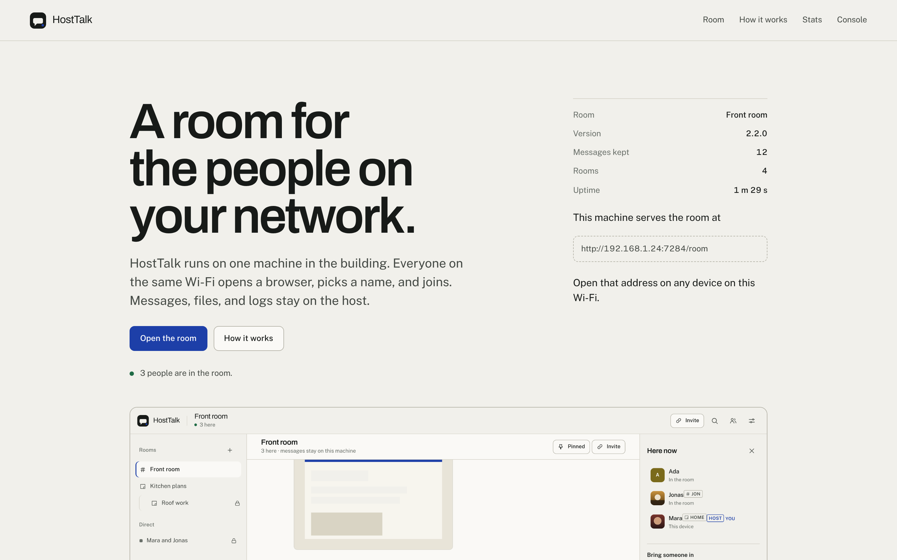

The join page states the promise, shows the address, and offers a QR code for a phone.

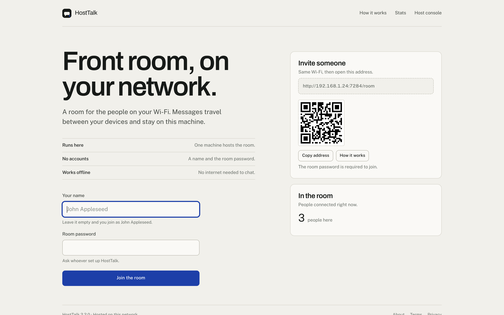

The invite sheet carries the QR code, the address, and the steps in order.

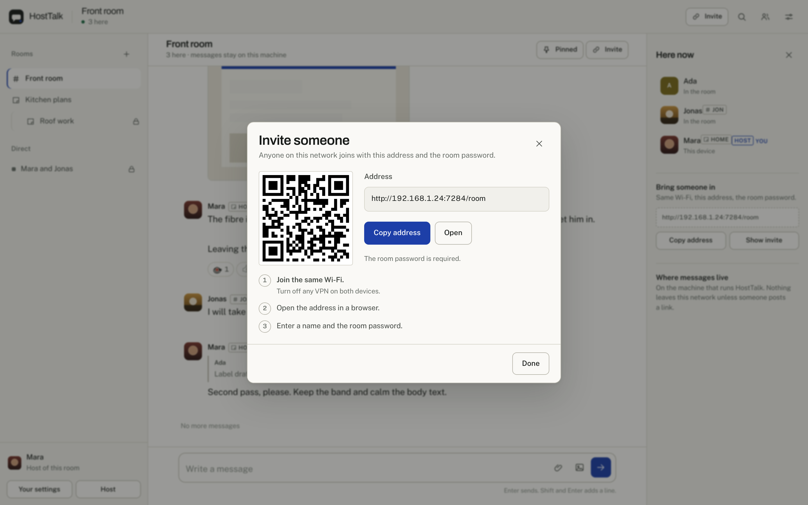

The host console puts checks, people, rooms, logs, and settings on one page.

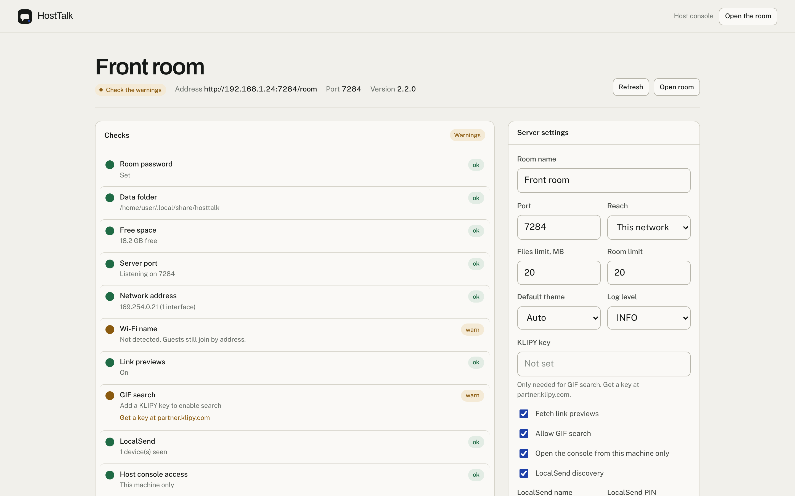

A phone gets the same room without an install step. The rail and people panel slide in from the edges.

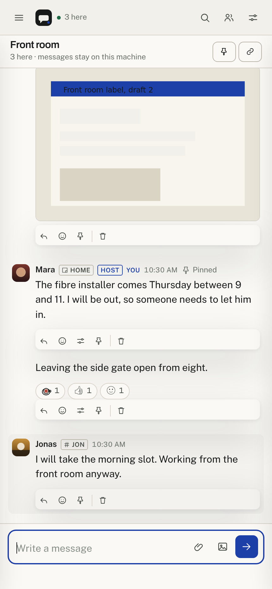

Dark theme follows the device, or the host sets a default.

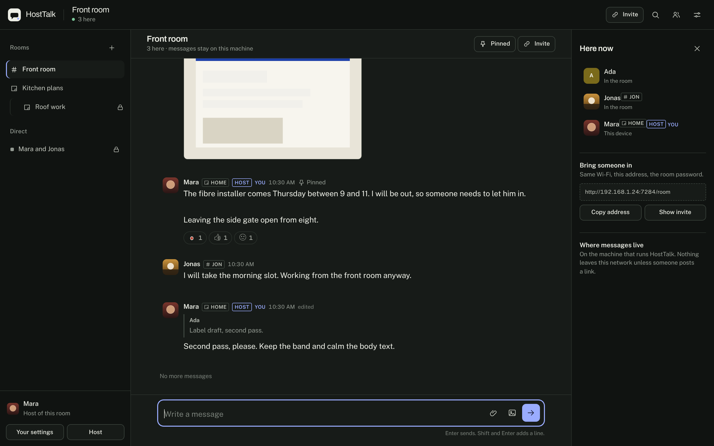

The marketing page explains the design and the limits of the tool.

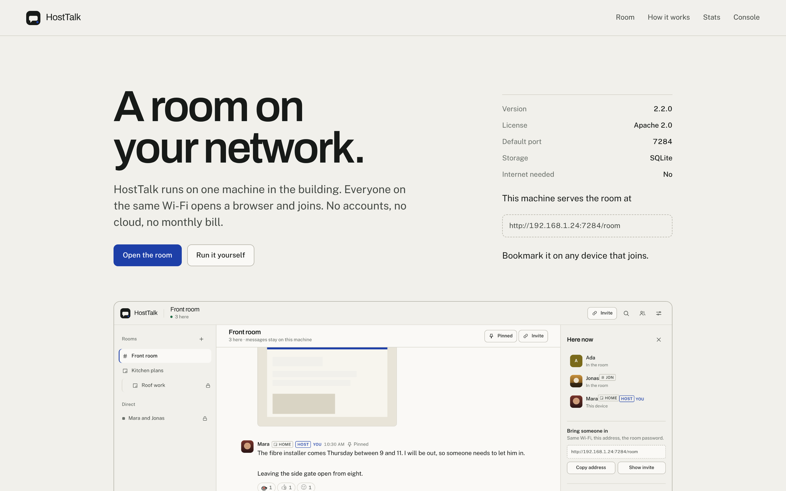

The stats page counts the instance, the code, and the versions under both.

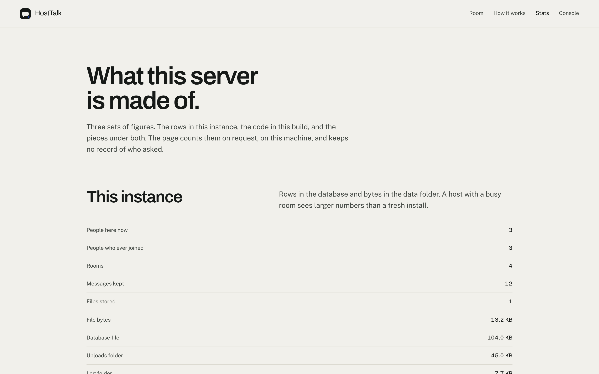

Terms and privacy pages ship as drafts with the review step marked.

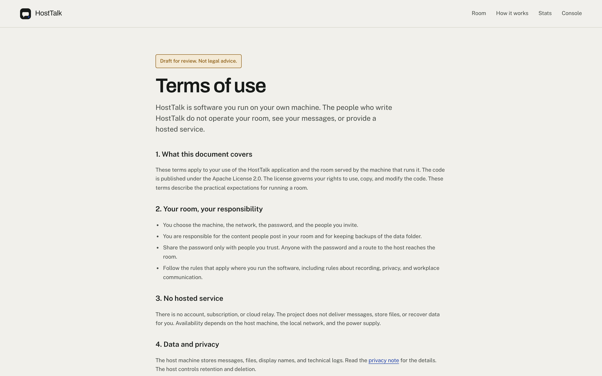

The full set sits in `static/screenshots`. Capture notes live in `docs/SCREENSHOTS.md`.

## Project stats

The app serves a stats page at `/stats`. Open the address on the host or from any device on the network.

Three tables, counted when the page loads:

- **This instance.** People here now, people who ever joined, rooms, messages kept, files, bytes for the database, uploads, and logs, uptime, listening port.
- **The code.** Lines and files for the server package, room scripts, styles, templates, tests, deployment files, and docs. Bundled libraries sit in a separate table, so the line total describes this project.
- **The build.** Version, codename, database schema, Python, Flask, Waitress, SQLite, platform, and route counts.

Figures come from two places. `store.stats()` reads rows. A walk of the install folder counts lines, files, and test functions. Nothing leaves the machine, and the page keeps no record of visitors. Message text, names, and addresses do not appear.

Source counts are cached for the life of the process. Instance figures are read on each request. If the database does not answer, the page still renders the code and build tables, and marks the instance table as missing. The code lives in `hosttalk/stats.py`, the markup in `templates/stats.html`.

## Project page

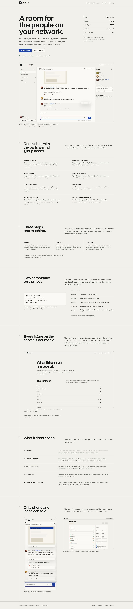

`site/index.html` is a static page about the project. React renders it, Tailwind supplies the styles, and Vite writes the build. The folder holds plain files with hashed asset names and relative paths. Publish `site/` anywhere: GitHub Pages, a bucket, a folder on the host. Flask does not serve it, so a running room never depends on it.

The page runs at <https://hosttalk.vercel.app>. The Vercel project takes `landing/` as its root, runs `cp -r ../site dist`, and serves `dist`. No install step and no second build, so the published files match the committed folder.

The page covers the product shot, eight features, the three steps a message takes, the two commands to start the server, the stats page, the limits, and the phone and console shots. Every download link points at the latest release.

### Source and build

The source sits in `landing/`. Copy lives in `landing/src/content.ts`, so a wording change touches one file. Components hold layout only.

```bash
cd landing
npm install
npm run dev      # http://localhost:5174, reloads on save
npm run build    # typechecks, then writes ../site
```

`npm run build` writes the files in `site/`. Commit the output with the source, so a clone serves the page without a Node toolchain. The build uses `base: "./"`, so the page works from any subfolder.

A test reads `site/index.html` and checks that every reference resolves and that paths stay relative. Another test keeps the demo label in the copy. Both catch a broken publish.

## How it works

Four moving parts, all on the host machine.

```
browser  --HTTP-->  Flask app  --SQL -->  SQLite
   ^                    |
   |                    +-- files --> uploads/
   +-- SSE stream <-----+-- events --> logs/

phone (LocalSend) --UDP 53317 + HTTP--> same Flask app
```

### Request path

1. A browser asks for `/`. Flask renders the front page with live counts and no script. The room lives at `/room`, where Flask renders the join view with a bootstrap JSON blob on the body element. The content security policy blocks inline script, so every script is a file under `static/js`.
2. The person posts a name and password to `/api/session`. The server checks the bcrypt hash, binds the name to a device key, and writes a signed session cookie.
3. The page opens `/api/events`, one server-sent event stream. The server keeps a subscriber per connection and pushes message, presence, and typing events through it.
4. A message posts to `/api/messages`. The server validates the text, writes a row, and publishes to the subscribers of the room. Every open browser paints the message without a refresh.

### Storage

SQLite in WAL mode, 10 tables: `users`, `rooms`, `room_members`, `attachments`, `messages`, `reactions`, `invites`, `custom_emoji`, `nickname_log`, `meta`. Message sequence numbers come from a per room counter, so pagination uses `before_seq` and stays stable while people type.

Uploads go to `uploads/` with a random name. The database keeps the original filename, MIME type, byte count, and digest.

### Sessions and names

There are no accounts. A name belongs to the first device which claims it. The device key lives in local storage, so the same browser returns to the same name. A second device with the same name gets a refusal, which keeps impersonation cheap to spot. The host clears stale names by deleting them from the console.

### Delivery

One long-lived HTTP response per browser. The broker keeps subscribers grouped by room, sends a heartbeat every 20 seconds, and drops dead connections. Reconnect is automatic through the browser's `EventSource` retry.

### Files and previews

Uploads stream to disk in 64 KB chunks with a hard byte cap. Images under 20 MB render inline from `/api/files/<id>` with `X-Content-Type-Options: nosniff`. Previews fetch with a 6 second timeout, a size cap, and a DNS check against private ranges, so a posted link does not probe the network from the host.

### LocalSend

The manager announces a `HostTalk` device over multicast, listens for announcements, and serves the LocalSend v2 endpoints: `/api/localsend/v2/info`, `register`, `prepare-upload`, `upload`, and `cancel`. Files land in the main room with the sender alias attached.

### Pages

| Path | Serves | Who |
| --- | --- | --- |
| `/` | Front page with live counts and links into the room | Anyone on the network |
| `/room` | Join screen, then the room | Anyone with the password |
| `/console` | Host console: checks, settings, logs, people | Host machine, signed in |
| `/about` | How the room works, its limits, and run notes | Anyone |
| `/stats` | Project stats: instance, code, build | Anyone |
| `/terms`, `/privacy` | Draft legal pages | Anyone |
| `/healthz` | JSON health check for a monitor | Anyone |
| `/manifest.webmanifest`, `/sw.js` | Install metadata and the offline shell | Browsers |

A link with `?join=CODE` on the root redirects to the room with the code intact, so invite links from earlier builds keep working. The room address carries the path, which means a scanned QR code opens the join screen and skips the front page.

## Run it

Python 3.10 or newer. No Node build step.

### Windows

```bat
git clone https://github.com/sarang-cmd/HostTalk
cd HostTalk
py -m venv .venv
.venv\Scripts\python -m pip install -r requirements.txt
deploy\hosttalk.bat
```

The batch file creates the virtualenv on first run, then starts the server and opens the browser.

The packaged builds from the Actions tab start the same way, with the desktop window and the app style browser. Download `HostTalk.exe` from the latest release.

### macOS and Linux

```bash
git clone https://github.com/sarang-cmd/HostTalk
cd HostTalk
python3 -m venv .venv
.venv/bin/pip install -r requirements.txt
.venv/bin/python server.py
```

The server prints a local address, a network address, and the console URL. It opens a browser unless `--headless` is set.

For the window, run `.venv/bin/python desktop.py`, or `hosttalk app`. The macOS release ships `HostTalk.app`. The Linux release ships a `HostTalk` binary.

## Desktop app

`desktop.py` starts the server in a thread, opens the room in an app style window, and shows a control window.

- **Control window.** The room name, the local address, the network address, a copy button, the console button, and a live count of people here.
- **App window.** Chrome, Edge, Brave, or Chromium opens the room without tabs or an address bar. Other machines fall back to the default browser.
- **Port fallback.** If the chosen port is busy, the app tries the next seven and shows the one it used.
- **Closing.** The window asks before it stops the room. The data folder is untouched.
- **No Tk.** On a machine without Tk, the app runs as a server and opens the browser.

Builds run in `.github/workflows/build.yml` on a tag. Each build produces an app and a server binary. The Windows exe takes `icon.ico` and the macOS app takes an `icns` made from the 512 px mark. The control window loads `static/icons/icon-192.png` on every platform.

### Container

```bash
cd deploy
docker compose up --build
```

The compose file sets `network_mode: host`, because multicast does not cross the default bridge. Set `SERVER_PASSWORD` before the first start.

## Set up the room

First run has no password. Two paths, same result.

**Browser.** Open `http://127.0.0.1:7284/console` on the host. The first screen asks for a room name, a host name, a host password, a join password, a port, the reach, and whether to look for LocalSend devices. Save. The console opens.

**Terminal.** One command, no prompts:

```bash
.venv/bin/python -m hosttalk setup --password "frontroom" --room "Front room" --port 7284
```

Then start the server and open the console. The console shows a check list. Green means fine. Amber means a setting needs attention, usually the KLIPY key or a Wi-Fi name the system does not report.

Change the password later with the console form, or:

```bash
.venv/bin/python -m hosttalk reset-password
```

## Deploy it

Service files and examples live in `deploy/`.

| Target | File | Notes |
| --- | --- | --- |
| systemd | `deploy/hosttalk.service` | Hardened unit, data in `/var/lib/hosttalk` |
| systemd helper | `deploy/install-service.sh` | Creates the user, the data folder, and the unit |
| launchd | `deploy/com.hosttalk.room.plist` | macOS, logs into the data folder |
| Docker | `deploy/Dockerfile` | Slim image, non-root user, health check |
| Compose | `deploy/docker-compose.yml` | Host network, named volume |
| Caddy | `deploy/Caddyfile` | Local HTTPS, buffering off for the event stream |
| nginx | `deploy/nginx.conf` | Reverse proxy with a long read timeout |
| Windows | `deploy/hosttalk.bat` | Local start from a folder with a virtualenv |

Install as a Linux service:

```bash
sudo cp -r . /opt/hosttalk
sudo bash /opt/hosttalk/deploy/install-service.sh
```

The unit sets `HOSTTALK_HOME=/var/lib/hosttalk`, restarts on failure, and keeps the data folder writable while the rest of the filesystem stays read only.

Put a proxy in front when you want a hostname or HTTPS. The event stream needs `proxy_buffering off` and a read timeout measured in hours, not seconds. Both example configs carry those settings.

## Settings

Settings live in `config.json` inside the data folder, mode 0600. The console edits the file through the API. Environment variables override the file for one run.

| Setting | Default | Console | Environment |
| --- | --- | --- | --- |
| Port | 7284 | yes | `HOSTTALK_PORT` |
| Bind address | 0.0.0.0 | yes | `HOSTTALK_BIND` |
| Room name | Front room | yes | `HOSTTALK_ROOM_NAME` |
| Files limit | 20 MB | yes | `HOSTTALK_MAX_UPLOAD_MB` |
| Room member cap | 20 | yes | `HOSTTALK_MAX_MEMBERS` |
| Default theme | auto | yes | `HOSTTALK_THEME` |
| Log level | INFO | yes | `LOG_LEVEL` |
| Link previews | on | yes | |
| GIF search | on, no key | yes | `KLIPY_API_KEY` |
| Host name | host | yes, host machine only | |
| Host password | set on first run | yes, host machine only | |
| Room locked | off | yes | |
| Read only | off | yes | |
| Slow mode | 0 seconds | yes | |
| Notice | empty | yes | |
| LocalSend | on | yes | `HOSTTALK_LOCALSEND`, `HOSTTALK_LS_PIN` |
| Console local only | on | yes | `HOSTTALK_CONSOLE_LOCAL_ONLY` |
| Data folder | platform default | CLI | `HOSTTALK_HOME` |

Changing the port or the bind address asks for a restart. The console says so and shows a marker until the server restarts.

## Command line

```
hosttalk serve [--port 7284] [--host 0.0.0.0] [--data-dir PATH] [--password ...] [--headless] [--no-browser] [--open-console] [--log-level INFO] [--no-localsend] [--reload]
hosttalk app [--port 7284] [--host 0.0.0.0] [--data-dir PATH] [--no-window] [--no-browser]
hosttalk setup [--password ...] [--room ...] [--port ...] [--data-dir PATH] [--non-interactive]
hosttalk config show | path | get KEY | set KEY VALUE [--data-dir PATH]
hosttalk reset-password [--password ...] [--data-dir PATH]
hosttalk doctor [--data-dir PATH]
hosttalk version
```

A command with no flags still reads the data folder from `HOSTTALK_HOME`, so a service file can pass the folder in the environment instead.

`server.py` is a thin entry which calls `hosttalk.cli.main`, so `python server.py` behaves like `python -m hosttalk serve`.

## HTTP API

All routes answer JSON with an `ok` field. Cookies carry the session. Every path under `/api` sends `Cache-Control: no-store`.

| Method | Path | Purpose |
| --- | --- | --- |
| GET | `/api/status` | Public settings for the join page |
| POST | `/api/setup` | First run, host machine only |
| POST | `/api/session` | Join with a name and password |
| DELETE | `/api/session` | Leave this device |
| GET | `/api/people` | Everyone, with the online flag |
| GET | `/api/invite` | The address for an invite |
| GET | `/api/me` | Current person, rooms, palette |
| PATCH | `/api/me` | Rename, change color, set a badge |
| POST | `/api/me/avatar` | Upload a profile picture |
| DELETE | `/api/me/avatar` | Remove a profile picture |
| GET | `/api/avatars/<user_id>` | Profile picture |
| GET | `/api/emoji` | Custom emoji |
| POST | `/api/emoji` | Add custom emoji, host only |
| DELETE | `/api/emoji/<id>` | Remove custom emoji, host only |
| GET | `/api/emoji/<id>/image` | The custom emoji picture |
| POST | `/api/people/<id>/role` | Change a role, host only |
| POST | `/api/messages/<id>/pin` | Pin or unpin a message |
| GET | `/api/rooms/<id>/pinned` | Pinned messages |
| POST | `/api/rooms/<id>/enter` | Enter a nested room |
| POST | `/api/rooms/<id>/password` | Set or clear a room password |
| GET | `/api/rooms/<id>/members` | People in a room |
| POST | `/api/host/credentials` | Host name and host password, host machine only |
| GET | `/api/events` | Server-sent event stream |
| GET | `/api/rooms` | Rooms for the signed in person |
| POST | `/api/rooms` | Create a group room |
| POST | `/api/rooms/join` | Join with an invite code |
| POST | `/api/rooms/<id>/leave` | Leave a room |
| POST | `/api/rooms/<id>/invite` | Create an invite code |
| POST | `/api/rooms/<id>/verify` | Check a room password |
| POST | `/api/dm` | Open a direct thread |
| GET | `/api/rooms/<id>/messages` | Page of messages |
| POST | `/api/messages` | Send text, file, or GIF |
| PATCH | `/api/messages/<id>` | Edit your message |
| DELETE | `/api/messages/<id>` | Delete your message |
| POST | `/api/messages/<id>/reactions` | Toggle a reaction |
| POST | `/api/typing` | Typing ping |
| POST | `/api/uploads` | Upload a file |
| GET | `/api/files/<id>` | Download a file |
| GET | `/api/previews` | Link preview, guarded |
| GET | `/api/gifs` | GIF search through the host |
| GET | `/api/search` | Search your rooms |
| POST | `/api/host/session` | Console sign in |
| GET | `/api/host/summary` | Checks, rooms, people, stats |
| PATCH | `/api/host/settings` | Save settings |
| POST | `/api/host/password` | Change the room password |
| DELETE | `/api/host/session` | Console sign out |
| GET | `/api/host/logs` | Filtered log records |
| GET | `/api/host/logs/download` | The log file as NDJSON |
| GET | `/api/host/people` | People, roles, and name changes |
| POST | `/api/host/users/<id>/role` | Move a role, host included |
| GET | `/api/host/diagnostics` | The check list again |
| POST | `/api/host/localsend/scan` | Scan for LocalSend devices |
| GET | `/api/host/theme-preview` | Theme colours |
| POST | `/api/host/theme` | Set the default theme |
| GET | `/api/host/export` | Room export as JSON |
| POST | `/api/host/rooms/<id>/clear` | Delete room messages |
| POST | `/api/host/users/<id>/disconnect` | End a session |
| POST | `/api/host/shutdown` | Stop the server, host machine only |
| GET | `/api/localsend/status` | LocalSend state |
| GET | `/api/localsend/devices` | Devices seen |
| POST | `/api/localsend/scan` | Scan the network |
| POST | `/api/localsend/send` | Send a file out |
| GET | `/api/localsend/v2/info` | LocalSend identity |
| POST | `/api/localsend/v2/register` | LocalSend discovery |
| POST | `/api/localsend/v2/prepare-upload` | LocalSend handshake |
| POST | `/api/localsend/v2/upload` | LocalSend file body |
| POST | `/api/localsend/v2/cancel` | LocalSend cancel |

Host routes need the console session cookie and, by default, a loopback address.

## Data folder

```
~/.local/share/hosttalk/        Linux
~/Library/Application Support/HostTalk/   macOS
%APPDATA%\HostTalk\            Windows
```

```
config.json      settings, password hash, secret key (0600)
hosttalk.db      messages, rooms, people, attachments, reactions
uploads/         files, random names
uploads/avatars  profile pictures, one per person
uploads/emoji    custom emoji the host added
logs/            hosttalk.jsonl, rotated at 2 MB, three backups
```

Copy the folder to back up everything. Delete a room in the console to remove its messages, or delete the folder to start over.

## Security model

What this build does:

- bcrypt for the room password and for locked direct threads, cost 12
- signed session cookie, HttpOnly, SameSite Lax, 30 days
- host console behind a host name and host password, plus a loopback check
- rate limits on join attempts, messages, uploads, and typing pings
- content security policy with `script-src 'self'` and no inline handlers
- `nosniff`, `SAMEORIGIN`, `no-referrer`, and a permissions policy on every response
- link previews refuse loopback, link local, and private addresses
- uploads capped by bytes during the stream, not after
- config file written atomically with mode 0600
- the stats page exposes counts and versions only, never message text or names

What it does not do:

- no end to end encryption, traffic inside the local network is plain HTTP
- no accounts, so a name is a claim, not an identity
- no relay across networks, a VPN or a tunnel is your job
- no cloud backup

Run HostTalk on hardware you control, on a network you trust.

## Tests

```bash
.venv/bin/pip install -r requirements-dev.txt
.venv/bin/ruff check hosttalk tests
.venv/bin/pytest
```

The suite covers config validation, store behaviour, the HTTP surface, the password flow, rate limits, uploads, preview guarding, the room member rules, the byte and duration formatting on the stats page, the source counts, the page with a closed database, and the 2.2 additions: house names, device identity, pictures, roles, pins, badges, custom emoji, rooms inside rooms, and the four host controls.

`tests/test_docs.py` reads the documents and checks the claims a reader acts on: one version string across the app, the container, and the service worker, no page naming the old GIF service, a route table that matches the code, the table count, and the palette size. GitHub Actions runs the same commands, then boots the app and asks `/healthz` for a real answer.

## Troubleshooting

**Guests see a login page but the join fails.** Check the password, then check the address. Print it with `python -m hosttalk doctor` on the host. A VPN on either device breaks local routing.

**The port is in use.** Pick another in the console, or run `python server.py --port 7300` for one session. On Windows, `netstat -ano | findstr 7284` shows the owner.

**LocalSend finds nothing.** Multicast needs a flat network. Guest Wi-Fi and client isolation block it. The UDP port is 53317.

**GIF search says it needs a key.** Get a key at `partner.klipy.com`, paste it into the console, save. The key stays on the host.

**The console refuses the host machine.** With `console_local_only` on, the console answers only loopback requests. Open it at `127.0.0.1`, not the network address.

**Logs are empty.** The console filters by level. Set the filter to all levels and press refresh.

## Repository layout

```
hosttalk/           server package
  app.py            app factory, page routes, headers
  cli.py            serve, setup, config, doctor
  config.py         settings, defaults, validation
  store.py          SQLite schema and queries
  auth.py           validation, palette, rate limits
  api_session.py    join, profile, presence, events
  api_chat.py       rooms, messages, reactions, search
  api_files.py      uploads, downloads, LocalSend
  api_host.py       console API
  diagnostics.py    check list for the console
  events.py         server-sent event broker
  localsend.py      discovery and transfer protocol
  previews.py       guarded link previews
  gifs.py           KLIPY client with cache
  api_emoji.py      custom emoji upload and serve
  api_common.py     serializers shared by the blueprints
  desktop.py        server, control window, app window
  logging_setup.py  JSON line logs, rotation, log reading
  netinfo.py        LAN address, Wi-Fi name, invite URL
  presence.py       who is here
  services.py       store, broker, presence, and console wiring
  stats.py          counts for the stats page and the front page
  version.py        version and codename
static/
  css               tokens, base, app, console, marketing
  js                core, emoji, render, app, console
  icons             favicon, touch icon, maskable mark, mark.svg
  fonts             Archivo, Public Sans, Noto Emoji
  screenshots       images used in this file
  lib               QR, compression, gzip helpers
templates/          landing, room, stats, console, about, terms, privacy, error
deploy/             systemd, launchd, Docker, proxies
tests/              pytest suite
docs/               notes on the screenshots and the social card
landing/            React and Tailwind source for the project page
site/               built pages, committed, served as plain files
```

## Credits

Type: Archivo and Public Sans, SIL Open Font License. Noto Emoji for reaction glyphs. QR encoding by `qrcode-generator`. Compression by `compressorjs` and `fflate`. The LocalSend protocol is defined by the LocalSend project.

The mark is drawn for this project. The code is Apache 2.0. The Terms and Privacy pages ship as drafts. Fill in the operator details before you publish a deployment.
